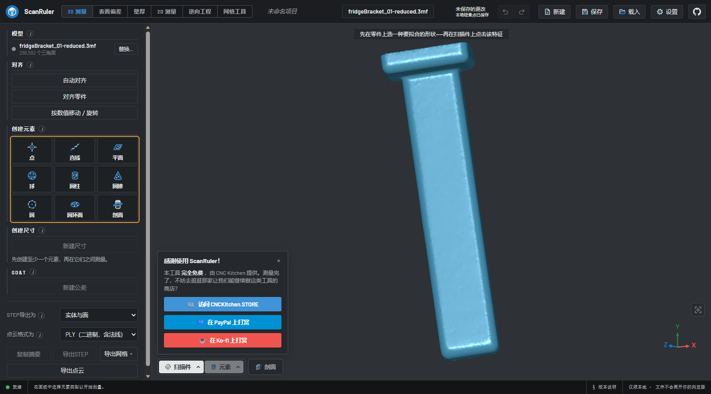
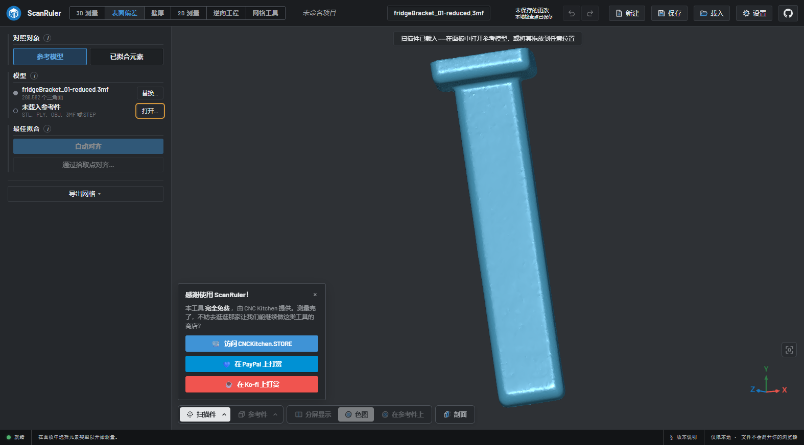
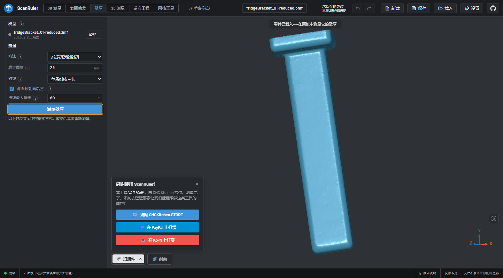
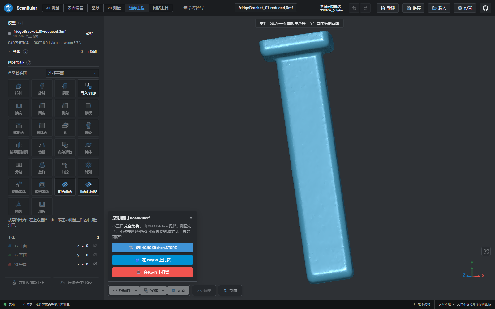
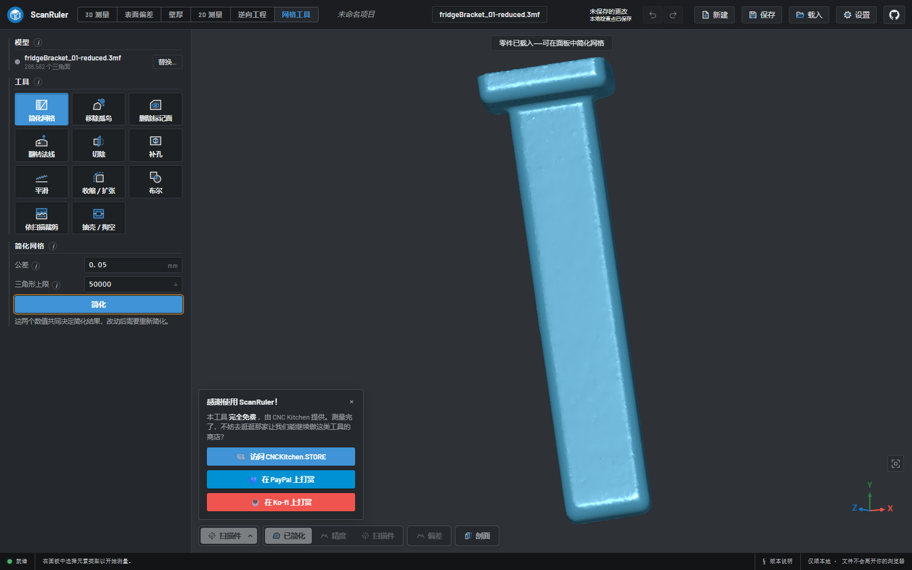

# ScanRuler 简体中文语言包

给 [ScanRuler by CNC Kitchen](https://github.com/CNCKitchen/ScanRuler) 用的 **简体中文界面补丁**。

上游软件是一个在浏览器里跑的 3D 扫描分析工具：在扫描网格上拟合球/圆柱/平面等元素做测量、做表面偏差与壁厚分析、并把扫描件逆向成参数化 CAD（可导出 STEP）。界面只有英文。

本项目**不修改上游源码**，而是在成型构建上运行一个运行时补丁：它盯着 DOM，把英文界面文本按词表替换成中文。上游更新了一照样能用，没译到的新句子自动保持英文。

- 词表 **6,500 条**，覆盖全部工作区、面板、提示、错误消息与工具提示
- 术语按机械制图 / 几何量计量 / CAD / 3D 打印的国标习惯译法（拟合、圆角、倒角、剖切、偏差、壁厚、基准……）
- 保留占位符，动态数值照常显示
- `Alt+Shift+L` 一键切回英文

## 截图

| | |
|---|---|
|  |  |
| 起始界面：未命名项目、拟合元素、打开示例扫描件 | 3D 测量：创建元素、创建尺寸、GD&T |
|  |  |
| 表面偏差：最佳拟合与偏差图 | 壁厚：射线法壁厚分析 |
|  |  |
| 逆向工程：草图、拉伸、旋转、螺纹 | 网格工具：简化、补孔、布尔、依扫描裁剪 |

## 两种用法

### 一、自建部署（推荐）

你已经把上游 clone 下来跑过 `npm run build`：

```bash
git clone https://github.com/q862877400-ux/scanruler-zh.git
cd scanruler-zh
npm run build                       # 生成 dist/scanruler-zh.js
node apply.mjs <ScanRuler 目录>      # 注入到那份构建的 dist/index.html
```

`apply.mjs` 会把脚本复制进 `dist/`、在 `index.html` 的 `</body>` 前插一行 `<script src="/scanruler-zh.js"></script>`，并把原文件备份成 `index.html.orig`。撤销：

```bash
node apply.mjs <ScanRuler 目录> --undo
```

刷新页面即可。语言选择存在 `localStorage['scanruler.lang']`。

### 二、油猴脚本

装了 Tampermonkey / Violentmonkey 的话，直接安装 [`dist/scanruler-zh.user.js`](dist/scanruler-zh.user.js)，默认匹配：

- `https://scanruler.com/*`
- `http://localhost/*`
- `http://127.0.0.1/*`

自建部署换了端口或域名，就自己加一条 `@match`。

## 词表怎么组织的

`i18n/` 下的 JSON 是「英文原文 → 中文」的扁平表，`build.mjs` 把它们合并成一份字典，和 `src/runtime.js` 打包成产物。

键就是界面上出现的**原文**，所以上游改了文案，那条就自动退回英文，等你补一条新的键即可 —— 不会错配到别的句子上去。

带动态数值的句子用 `{0}`、`{1}` 当占位符：

```json
{ "{0} triangles": "{0} 个三角形",
  "Fit {0} {1} at {2}": "在 {2} 处拟合 {0} {1}" }
```

运行时按模板匹配，把活的值塞回中文语序里。

## 补词表

1. 打开界面，按 `F12`，在控制台执行 `window.scanrulerZh.missing()` —— 返回当前页面所有没被翻到的英文原文。
2. 把需要的条目加进 `i18n/` 里任意一个 JSON（建议 `i18n/zh-extra.json`）。
3. `npm run build`，刷新。

`tools/` 下有几个开发用的脚本：从构建产物提取候选字符串、在浏览器里抓取实际渲染文本、校验词表（占位符一致性、残留英文、术语同义词）。

## 许可与归属

- 本项目：**AGPL-3.0-only**，与上游一致。
- 上游 [ScanRuler](https://github.com/CNCKitchen/ScanRuler) 作者是 Stefan Hermann（CNC Kitchen），本项目不包含其任何源码，只在运行时替换界面文本。
- 「CNC Kitchen」「ScanRuler」是 CNC Kitchen 的商标，不在代码许可范围内。
- 思路参考了俄语社区的做法（[Nikita7x/ScanRuler-ru](https://github.com/Nikita7x/ScanRuler-ru) 的源码内建语言开关、[Evgeniy2225/scanruler-ru](https://github.com/Evgeniy2225/scanruler-ru) 的运行时词表补丁），中文词表与运行时实现为本项目独立编写。

## English

A Simplified Chinese UI patch for [ScanRuler by CNC Kitchen](https://github.com/CNCKitchen/ScanRuler). It runs on top of an unmodified build, watches the DOM, and swaps English interface strings for Chinese from a 6000+ entry dictionary; strings added upstream later simply stay English until translated. No source fork, no rebuild of the app.

Install into a self-built deployment with `npm run build && node apply.mjs <dir>`, or install `dist/scanruler-zh.user.js` in Tampermonkey. `Alt+Shift+L` toggles between Chinese and English. Licensed AGPL-3.0-only, like upstream. "ScanRuler" and "CNC Kitchen" are trademarks of CNC Kitchen and are not covered by the code license.
